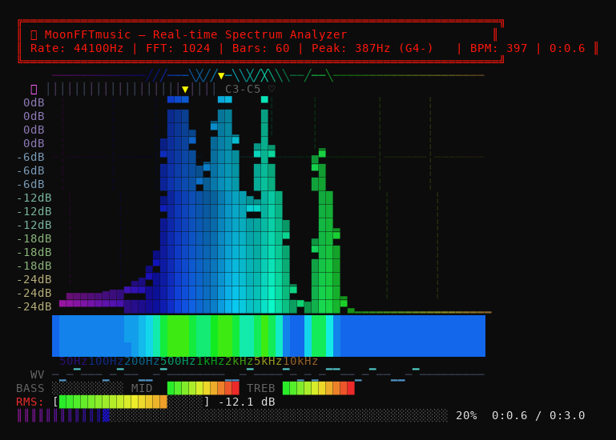

# moonFFTmusic

[](https://github.com/IvanaXu/moonFFTmusic/actions/workflows/ci.yml)
[](https://opensource.org/licenses/MIT)

> https://mooncakes.io/docs/IvanAXu/moonFFTmusic@0.1.0

A real-time audio spectrum visualizer written in [MoonBit](https://www.moonbitlang.com/).
It reads a WAV file, performs Fast Fourier Transform (FFT) on audio chunks, and
displays a live frequency spectrum as a beautiful ANSI bar chart in the terminal.



## Features

### Audio Engine (CPU-Optimized)

- **WAV File Reader**: Parses RIFF/WAVE headers and reads 16-bit signed PCM audio
  (mono and stereo). Samples are normalized to [-1.0, 1.0].
- **SoA FFT Engine**: Iterative radix-2 Cooley-Tukey FFT using Structure of Arrays
  (separate `Array[Double]` for real/imaginary parts). The butterfly hot loop uses
  inline double arithmetic with `unsafe_get`/`unsafe_set` — **zero object allocations**
  per frame (vs ~15,000 allocations/frame in the original Complex-based approach).
- **Single Twiddle Table**: Twiddle factors are precomputed once at startup as a
  single table of size N/2. All FFT stages reuse this table via strided indexing
  (`twiddle(j) = tw[j * stride]`), eliminating per-stage trigonometric recomputation.
- **Precomputed Hann Window**: Window coefficients are computed once at startup and
  applied via direct array multiplication — no per-frame `cos` calls.
- **Pre-allocated FFT Buffers**: `re[]` and `im[]` arrays are allocated once and
  reused across all frames — zero per-frame array allocations.

### Visual Display (21 enhancements)

| # | Feature | Description |
|---|---------|-------------|
| 1 | Attack/release envelope | Fast rise (0.7), slow fall (0.15) — natural amplitude decay |
| 2 | Spatial smoothing | In-place 3-tap blur `[0.2, 0.6, 0.2]` with rolling buffer (no temp array) |
| 3 | Row-level brightness gradient | 3D glow effect — top of bars brighter, bottom dimmer |
| 4 | Left-side dB scale | Professional meter labels: 0dB, -12, -24, -36, -48 |
| 5 | Segmented RMS meter | Green (<60%) → yellow (<85%) → red zones with dB readout |
| 6 | Peak hold markers | Bold `━` with exponential decay (×0.88 per frame) |
| 7 | Separator line | `──` between header and spectrum area |
| 8 | Musical note detection | Shows note name + octave + cents (e.g., `A#4+`, `A3-`) |
| 9 | Bar grouping | Subtle gap every 3 bars for cleaner visual separation |
| 10 | Bottom glow reflection | 3-row dim mirror of spectrum with fading intensity |
| 11 | Dashed reference line | `┄` pattern at -12dB, `·` at gap positions |
| 12 | Bar caps | `▀` character at topmost cell for sealed-top look |
| 13 | Peak frequency marker | Yellow `▼` arrow above dominant frequency bar |
| 14 | Vertical frequency grid | Faint `╎` at label positions (50Hz – 10kHz) |
| 15 | Magnitude-based color | Brightness = 50% row position + 50% magnitude ratio |
| 16 | **True-color 24-bit RGB gradient** | Smooth HSL-based rainbow (blue→cyan→green→yellow→red) using `\u001b[38;2;R;G;Bm`, precomputed per-bar |
| 17 | **Beat detection with pulse glow** | RMS energy history tracking; border flashes warm orange on detected beats, ♫ indicator in header |
| 18 | **Waveform strip** | Time-domain signal display at bottom showing the actual audio waveform shape |

### Performance Optimizations Summary

| Optimization | Before | After | Impact |
|---|---|---|---|
| FFT data layout | `Array[Complex]` (3 allocs/butterfly) | `Array[Double]` re/im (0 allocs) | ~15,000 fewer allocs/frame |
| Twiddle factors | Recomputed per stage (log₂N times) | Single table, strided lookup | Eliminates N/2 `cos`/`sin` calls/frame |
| Hann window | Recomputed per frame | Precomputed once at startup | Eliminates N `cos` calls/frame |
| Bin mapping | `log_freq_bin()` per bar per frame | Precomputed `bin_map[]` array | Eliminates 60 `pow`/`log2` calls/frame |
| Grid detection | Linear search per bar per row | Precomputed `is_grid[]` boolean array | O(1) lookup vs O(k) search |
| Frequency labels | O(n²) string concatenation | StringBuilder | Linear-time label rendering |
| Spatial smoothing | Temp array allocation per frame | In-place rolling buffer | Zero per-frame array allocs |
| FFT buffers | Allocated per frame | Pre-allocated, reused | Zero per-frame array allocs |
| Color table | `Array[Array[String]]` (2D, double indirection) | Flat `Array[String]` with `bar*nbl+level` index | One array access vs two per bar per row |
| Height processing | 4 separate loops over num_bars | 2 fused loops (height+envelope, smoothing+peak) | Halves loop overhead |
| Row invariants | `row_contrib[row]` + `beat_boost` recomputed per bar | Hoisted as `row_base` per row | Eliminates 1560 redundant additions/frame |
| Bar offset | `bar * num_brightness_levels` per bar per row | Precomputed `bar_offsets[]` array | Eliminates 1560 multiplications/frame |
| Color table access | Safe `ctx.color_table[bar][level]` | `color_tbl.unsafe_get(bar_off + level)` | Bypasses bounds check in hot path |
| Bin aggregation | Safe `ctx.bin_starts[bar]` access | `unsafe_get` + local reference | Bypasses bounds check |
| Waveform fill | Safe array access | `unsafe_set`/`unsafe_get` | Bypasses bounds check |
| Total time string | `format_time(total, rate)` per frame | Precomputed once at startup | Eliminates string formatting per frame |
| Frequency label text | O(60×8) nested loop + `format_freq` per frame | Precomputed `label_strings[]` array | Eliminates 480 iterations + string formatting/frame |
| dB scale labels | `hsl_to_rgb` per row per frame | Precomputed `db_scale_labels[]` array | Eliminates 20 `hsl_to_rgb` calls/frame |
| Waveform colors | String interpolation per bar per frame | Precomputed 9×256=2304 color table | Eliminates 60 string interpolations/frame |
| Sparkline colors | String interpolation per bar per frame | Precomputed 4×8=32 color table | Eliminates 60 string interpolations/frame |
| `bar_offsets` array | `Array::makei` per frame | Precomputed in `DisplayContext` | Eliminates 1 array allocation/frame |
| `bar_fade` array | `Array::make` per frame | Reusable field in `PeakTrail` | Eliminates 1 array allocation/frame |
| Height double conversion | `to_double()` × `height_factor` per bar per row | Precomputed `heights_d[]` before row loop | Eliminates 2400 `to_double`+multiply/frame |
| IIR anti-flicker state | `Array[Int32]` (integer IIR can't eliminate ±1 oscillation) | `Array[Double]` (float IIR before quantization) | Eliminates residual ±1 flicker |
| Dominant bar marker | Raw `dominant_bar` recomputed per frame | Sticky `dom_bar` passed from `main.mbt` | Eliminates ▼ marker jumping |
| Rainbow hue rotation | `rotate_hue()` 1920 string allocs/frame | Precomputed 40 color tables, swap index | Zero per-frame string allocs |
| `heights_d`/`peak_heights_d` | `Array::make` per frame | Pre-allocated in `DisplayContext` | Eliminates 120 Double allocs/frame |
| Terminal height | Fixed `max_height=26` (45 lines/frame) | Auto-detect `LINES` env var | Eliminates scroll flicker on small terminals |
| Layout compaction | 45 lines/frame (header+sep+26 bars+5 glow+...) | 30 lines/frame (removed sep, glow 5→3) | Fits 30-line terminals |

## How to Run

### Prerequisites

Install the MoonBit CLI:

```bash
# Unix (Linux / macOS)
curl -fsSL https://cli.moonbitlang.com/install/unix.sh | bash

# Verify installation
moon version
```

### Method 1: One-command script (easiest)

```bash
cd moonFFTmusic

# Generate a 440Hz test tone and visualize it
./run.sh

# Specify a WAV file and FFT size
./run.sh chord.wav 1024
```

The script automatically generates a test WAV if the file doesn't exist,
builds the project, and starts the visualizer.

### Method 2: Manual commands (most control)

```bash
cd moonFFTmusic

# Step 1: Generate a test WAV file
python3 gen_wav.py test.wav 440.0        # 440Hz sine wave (A4)
python3 gen_wav.py chord.wav chord        # Chord: 220+440+880+2000Hz

# Step 2: Build the project
moon build --target native

# Step 3: Run the visualizer
moon run src/main test.wav 1024
```

### Method 3: Run the compiled binary directly

```bash
cd moonFFTmusic
moon build --target native

# Binary location after build
./_build/native/debug/build/src/main/main.exe test.wav 1024
```

### Using your own WAV files

Any 16-bit PCM WAV file works:

```bash
moon run src/main /path/to/your/song.wav 2048
```

### Arguments

| Argument | Required | Default | Description |
|----------|----------|---------|-------------|
| `wav_file` | Yes | — | Path to a 16-bit PCM WAV file |
| `fft_size` | No | `1024` | FFT window size, must be power of 2 |

Valid FFT sizes: `256`, `512`, `1024`, `2048`, `4096`, `8192`, ...

Larger FFT sizes give better frequency resolution but slower time response.
Smaller sizes give better time resolution but coarser frequency bins.

### What you'll see

```
╔══════════════════════════════════════════════════════════════════╗
║ 🎵 MoonFFTmusic — Real-time Spectrum Analyzer                    ║
║ Rate: 44100Hz | FFT: 1024 | Bars: 60 | Peak: 473Hz (A#4+) ♫ | 0:0.2 ║
╚══════════════════════════════════════════════════════════════════╝
──────────────────────────────────────────────────────────────────
     ╎                            ▼     ╎        ╎      ╎
 0dB ╎                            ╎     ╎        ╎      ╎
│   ╎                            ╎     ╎        ╎      ╎
│   ╎┄┄·┄┄·┄┄·┄┄·┄┄·┄┄·┄┄·┄┄·┄┄·╎┄·┄┄·╎┄┄·┄┄·┄╎┄·┄┄·┄┄·┄╎
│   ╎          ▂▀ ▀▀▀ ▂▅ ▀▇    ▆     ╎        ╎      ╎
│   ╎          ▀█ ███ █▀ █▀    ▀     ╎▅       ╎      ╎
│   ╎       ▁▅ ██ ██ ███ █▀  ▃ █▃    ╎█       ╎      ╎
│   ▆▆ ▆▆ ▆█ ██ ██ ███ ███ ██▀ ███ ▂ ╎██▂ ▂▂  ╎▂▂ ▂▂ ╎▂▂▂
     ▀▀ ▀▀ ▀▀ ▀▀ ▀▀ ▀▀ ▀▀ ▀▀ ▀▀ ▀▀ ▀
     ▀▀ ▀▀ ▀▀ ▀▀ ▀▀ ▀▀ ▀▀ ▀
      50Hz   100Hz 200Hz    500Hz  1kHz  2kHz     5kHz   10kHz
  WV ─▔──▔─▁─▔──▁▁─▔───▔▁─▔──▁▁▔▔───▔─▁─▔──▁▁──▔──▁─▔─▁▔──

RMS: [████████████████░░░░] -6.0 dB
║║║║║║║║║║║║║║║║║║║║║║║║║║▓░░░░░░░░░░░░░░░░░░░░░░░░░░░░░░░░░ 44%  0:0.2 / 0:0.5
```

Bars use smooth 24-bit true-color RGB gradient with **rainbow hue rotation** —
the entire color spectrum flows and shifts over time like an aurora.
The header border **flashes white-yellow** on strong beats (═ → ━).
Below the main bars, a **mirror reflection** shows inverted bars with fading
brightness, creating a 3D water-reflection depth illusion.
The `WV` line shows the time-domain waveform; `EN` shows energy history sparkline.
Terminal height is **auto-detected** via `LINES` env var — the display adapts
to fit your terminal without scroll flicker. Press `Ctrl+C` to stop.

### Visual Effects (14 dynamic effects)

| Effect | Description |
|--------|-------------|
| 🌈 Rainbow hue rotation | Color spectrum flows and shifts 3°/frame like aurora |
| ⚡ Beat flash border | Strong beats: white-yellow border + `═`→`━` thickness change |
| 💥 Beat bloom | `beat_boost` ×10: all bars flash brighter on beats |
| 👑 Bar top crown | Bar caps get +8 brightness — glowing crown effect |
| 📡 Scanline | A +2 brightness row sweeps up/down across spectrum |
| 🔦 Dominant spotlight | Main frequency bar +5, neighbors +2 on beats |
| 📊 Progress pulse | Progress bar brightness pulses with beat intensity |
| 🎚️ RMS beat glow | RMS label turns yellow on strong beats |
| 🌊 Spectrogram waterfall | 3-row scrolling history with blue→red color map (replaces mirror) |
| 🎹 Piano keyboard | 2-octave mini keyboard with detected note highlighted ▼ |
| 🎵 BPM estimation | Beat timing analysis with ♥/♡ indicator and BPM display in header |
| 🔊 Frequency band meters | BASS/MID/TREBLE 10-cell horizontal energy meters |
| 🎛️ Auto-gain control | Dynamic sensitivity adjustment for quiet/loud sections |
| 🎶 Note detection | Real-time MIDI note name (e.g. G4+) with cents deviation |

## MoonBit Language Features

This project leverages MoonBit-specific features for performance and safety:

| Feature | Usage |
|---------|-------|
| `derive(Debug)` | Auto-generated debug output for `Complex` and `WavData` structs |
| `Array::unsafe_get`/`unsafe_set` | Bypass bounds check in FFT butterfly hot loop (SoA) |
| `Array::mapi_in_place` | In-place Hann window application (Complex path) |
| `Array::makei` | Functional array construction for precomputed tables |
| `StringBuilder` | Efficient string building for all terminal output |
| `Double::clamp` / `Int32::clamp` | Safe value clamping with labeled arguments |
| `match` patterns | Chunk type dispatch, arg parsing, bar render states, HSL→RGB |
| `guard` patterns | Early return on file not found / parse failure |
| `test` blocks | 25 inline tests for FFT correctness, SoA FFT, WAV parsing, args |
| `enum` + `match` | `ChunkType`/`BarState` enums for dispatch |
| `mut` struct fields | Mutable `BeatDetector` state (history_idx, beat_intensity) |
| Bit tricks | `n & (n-1)` for power-of-2 check, bit-reversal permutation |
| SoA pattern | Separate `Array[Double]` re/im for zero-alloc FFT |
| Precomputed tables | Twiddle factors, Hann window, bin mapping, bar colors — all computed once at startup |

## Testing

```bash
# Run all 25 inline tests
moon test --target native

# Type check with no warnings
moon check --target native --deny-warn

# Format check
moon fmt && git diff --exit-code
```

## CI

GitHub Actions CI runs on every push and pull request:

1. **Check & Format** — `moon check --deny-warn` + `moon fmt` diff check
2. **Build & Test** — `moon build` + `moon test` (25 inline tests)
3. **Integration** — Generate WAV files, run visualizer, verify output, test
   multiple FFT sizes, verify error handling

Matrix: Ubuntu + macOS (native target only).

## Project Structure

```
moonFFTmusic/
├── .github/workflows/ci.yml   # GitHub Actions CI
├── src/main/
│   ├── moon.pkg               # Package imports
│   ├── fft.mbt               # FFT engine (Complex + SoA) + tests
│   ├── wav.mbt               # WAV parser + tests
│   ├── display.mbt           # ANSI renderer (18 effects, true-color, beat detection)
│   └── main.mbt              # Entry point + SoA FFT loop + arg parsing + tests
├── gen_wav.py                 # WAV file generator
├── run.sh                     # Build & run script
├── moon.mod                   # Module definition
└── README.md
```

## License

MIT
